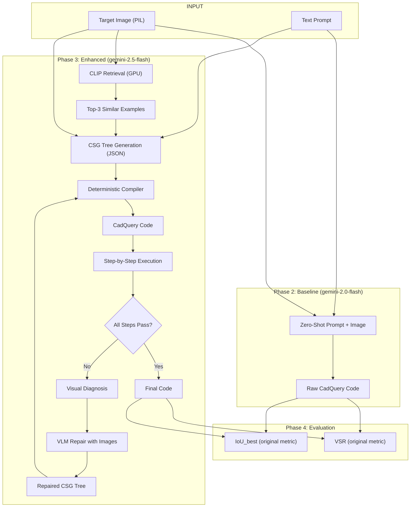

# Implementation Plan — CadQuery Code Generator Technical Test (Revised)

## 0. System & API Audit Results

### Hardware Available

| Resource | Value | Status |
|:---------|:------|:-------|
| CPU | Intel i7-14650HX, 24 logical cores | ✅ Ready |
| RAM | 31.7 GB total, ~8.6 GB free | ✅ Ample |
| GPU | NVIDIA RTX 4060 Laptop, 8 GB VRAM, Compute 8.9 | ⚠️ Not usable yet |
| Disk | 953 GB total, 684 GB free | ✅ Ample |
| PyTorch | `2.13.0+cpu` — **CPU-only build installed** | 🔴 Must reinstall with CUDA |
| CUDA driver | 592.82 | ✅ Driver ready |

> [!WARNING]
> **PyTorch is installed without CUDA support.** Despite having an RTX 4060 with driver 592.82, `torch.cuda.is_available()` returns `False` because the installed wheel is `torch+cpu`. We must reinstall `torch` with CUDA to leverage the GPU for CLIP embeddings, local model inference, and mesh voxelization acceleration.

### Gemini API Key

| Check | Result |
|:------|:-------|
| Key valid? | ✅ Yes — lists models successfully |
| Tier | 💳 Paid ($10/mo subscription) |
| Credits | 🔴 **DEPLETED** — `"Your prepayment credits are depleted"` |
| Available models | `gemini-2.5-flash`, `gemini-2.5-pro`, `gemini-3.5-flash`, `gemini-3.6-flash`, and more |

> [!CAUTION]
> **Action required before any API calls**: Top up credits at [AI Studio Billing](https://ai.studio/projects). Until credits are restored, all Gemini API calls will fail with `429 RESOURCE_EXHAUSTED`. The 100-sample evaluation will require ~200-400 API calls total (baseline + enhanced with retries), which should cost well under $1 at flash model pricing.

---

## 1. Audit of Previous Model's Work (unchanged from v1)

9 critical flaws identified — most importantly:
- **Images were never passed** to the models (the entire task is image→code)
- **Prompts were generic stubs** like `"Generate CadQuery script for shape sample_000204"`
- **`hundred_subset` column ignored** — random 30-sample split used instead
- **Provided metric files were modified** — evaluation contract broken
- **IoU scores near-zero** (0.03-0.04) — essentially random overlap

Your [my_implementation_plan.md](file:///c:/Users/IESL%20LAB%202/OneDrive/Documents/mecagent-technical-test/my_implementation_plan.md) was significantly better than what was executed. We incorporate its RAG retrieval strategy and add your new advanced CAD techniques.

---

## 2. Proposed Changes — Clean Rebuild

### Phase 0 — Environment Fix

#### [MODIFY] [pyproject.toml](file:///c:/Users/IESL%20LAB%202/OneDrive/Documents/mecagent-technical-test/pyproject.toml)
```diff
 dependencies = [
     "cadquery>=2.5.2",
     "datasets>=3.6.0",
     "google-genai>=0.1.1",
     "ipykernel>=6.29.5",
     "matplotlib>=3.8.0",
     "pillow>=10.0.0",
     "scipy>=1.15.3",
-    "torch>=2.1.0",
     "tqdm>=4.66.0",
     "trimesh>=4.6.11",
+    "transformers>=4.44.0",
+    "accelerate>=0.33.0",
 ]
+
+[tool.uv]
+# Install PyTorch with CUDA 12.8 support from PyTorch index
+extra-index-url = ["https://download.pytorch.org/whl/cu128"]
```

Then:
```bash
uv pip install torch --index-url https://download.pytorch.org/whl/cu128
uv sync
```

#### Restore provided metric files
```bash
git checkout dc94ef8 -- metrics/valid_syntax_rate.py metrics/best_iou.py
```

#### Restore original notebook
```bash
git checkout dc94ef8 -- good_luck.ipynb
```

---

### Phase 1 — Data Loading

#### [NEW] `src/data_loader.py` (complete rewrite)

Uses the dataset's built-in `hundred_subset=True` column for evaluation:

```python
class DataManager:
    def get_eval_subset(self) -> list[dict]:
        """Filter test split by hundred_subset==True. Returns ~100 samples.
        Each item: {id, image (PIL), cadquery (str), prompt (str), deepcad_id}
        """
    
    def get_training_samples(self, n=5000, seed=42) -> list[dict]:
        """Sample n training items for CLIP retrieval index."""
    
    def get_sample_image(self, split, idx) -> PIL.Image:
        """Retrieve a single sample's image."""
```

Key difference: **returns PIL images** alongside code (previous version cached only text to JSON).

---

### Phase 2 — Baseline Model (Image-Aware Zero-Shot)

#### [NEW] `src/models/baseline.py` (rewrite)

```python
class BaselineGenerator:
    """Zero-shot: image + simple prompt → CadQuery code via gemini-2.0-flash."""
    
    def generate(self, image: PIL.Image, prompt: str = "") -> str:
        """
        System prompt: "You are a CadQuery expert. Given this image of a 3D CAD 
        object, write Python code using CadQuery that recreates it. Assign the 
        final result to `result`. Output only executable Python code."
        
        Contents: [image, system_prompt + user_prompt]
        Model: gemini-2.0-flash (weaker model for baseline)
        No repair, no retrieval — pure zero-shot.
        No hardcoded fallback — honest failure if generation fails.
        """
```

---

### Phase 3 — Enhanced Model (The Core Innovation)

This phase implements your two advanced CAD design techniques plus RAG retrieval.

#### Enhancement A: CSG Tree JSON Intermediate Representation

> *"Instead of asking the model to write Python code right away, ask it to generate a constructive solid geometry tree in JSON format, then use a deterministic script to translate it into CadQuery code."*

This is a powerful idea because:
- The VLM reasons about **geometry** (shapes, dimensions, operations) rather than Python syntax
- A **deterministic translator** guarantees syntactically valid CadQuery code 100% of the time
- It separates "what to build" (VLM's job) from "how to express it" (compiler's job)

#### [NEW] `src/csg_schema.py`

Defines the CSG tree JSON schema and the deterministic CadQuery compiler:

```python
CSG_SCHEMA = {
    "type": "object",
    "properties": {
        "steps": {
            "type": "array",
            "items": {
                "type": "object",
                "properties": {
                    "operation": {"enum": [
                        "box", "cylinder", "sphere", "cone",
                        "extrude", "cut", "fillet", "chamfer",
                        "hole", "cboreHole", "shell",
                        "union", "intersect", "subtract"
                    ]},
                    "params": {"type": "object"},
                    "workplane": {"type": "string"},
                    "face_selector": {"type": "string"},
                    "target": {"type": "string"}  # variable name
                }
            }
        }
    }
}

# Example CSG tree:
EXAMPLE_CSG_TREE = {
    "steps": [
        {"operation": "box", "params": {"length": 80, "width": 60, "height": 10}, 
         "workplane": "XY", "target": "base"},
        {"operation": "hole", "params": {"diameter": 22}, 
         "face_selector": ">Z", "target": "base"},
        {"operation": "fillet", "params": {"radius": 2}, 
         "edge_selector": "|Z", "target": "base"}
    ]
}

def compile_csg_to_cadquery(csg_tree: dict) -> str:
    """
    Deterministic translation of CSG tree → CadQuery Python code.
    
    Guarantees:
    - Valid Python syntax
    - Correct CadQuery method chaining
    - Proper import statement
    - Result assigned to `result` variable
    
    Returns executable CadQuery code string.
    """
```

#### Enhancement B: Visual Construction Feedback Loop

> *"Show the model a step-by-step construction instead of just the final result, so the VLM can see which line of code broke the geometry."*

#### [NEW] `src/visual_feedback.py`

```python
class VisualFeedbackLoop:
    """Execute CadQuery code step-by-step, rendering intermediate 3D states."""
    
    def execute_stepwise(self, csg_tree: dict) -> list[dict]:
        """
        For each step in the CSG tree:
        1. Compile steps[0..i] into partial CadQuery code
        2. Execute to get intermediate solid
        3. Render to PIL image (using CadQuery's SVG/STL export + trimesh)
        4. Return list of {step_index, code_so_far, solid, rendered_image, success, error}
        
        If step N fails, we know exactly which operation broke.
        """
    
    def diagnose_failure(self, step_results: list[dict]) -> dict:
        """
        Identify the first failing step and return:
        {
            "failed_step_index": int,
            "failed_operation": str,
            "error_message": str,
            "last_good_image": PIL.Image,  # render of last successful state
            "last_good_code": str
        }
        """
    
    def repair_with_visual_context(self, diagnosis: dict, 
                                    original_image: PIL.Image,
                                    csg_tree: dict) -> dict:
        """
        Send to VLM:
        - The target image (what we want)
        - The last good intermediate render (what we have so far)
        - The failed step + error message
        - Ask: "The construction succeeded up to this point [image]. 
                Step {N} ({operation}) failed with: {error}. 
                Fix this step to match the target [image]."
        
        Returns repaired CSG tree.
        """
```

This is dramatically better than the previous model's repair loop because:
1. The model sees **where construction went wrong** visually
2. It can compare "what I have" vs "what I want"
3. Repairs are targeted at a **single step**, not the entire script

#### Enhancement C: CLIP-Based Retrieval-Augmented Few-Shot

#### [NEW] `src/retriever.py`

```python
class CLIPRetriever:
    """CLIP embedding index over training images for similarity retrieval.
    Runs on GPU (RTX 4060) for fast embedding."""
    
    def __init__(self, model_name="openai/clip-vit-base-patch32", device="cuda"):
        # CLIP on GPU: ~600MB VRAM, embeds ~100 images/sec
    
    def build_index(self, train_samples: list[dict], cache_path="data/cache/clip_index.npz"):
        """Embed training images, cache to disk. ~5K images in ~50 seconds on GPU."""
    
    def retrieve(self, query_image: PIL.Image, k=3) -> list[dict]:
        """Top-k most similar training samples by cosine similarity."""
```

#### [NEW] `src/models/enhanced.py` (complete rewrite)

```python
class EnhancedGenerator:
    """
    Enhanced pipeline:
    1. CLIP retrieval → dynamic few-shot examples
    2. CSG tree generation (structured JSON, not raw code)
    3. Deterministic compilation to CadQuery
    4. Visual step-by-step execution & feedback repair
    """
    
    def __init__(self, retriever, model="gemini-2.5-flash"):
        self.retriever = retriever
        self.model = model
    
    def generate(self, image: PIL.Image, prompt: str = "") -> str:
        # Step 1: Retrieve similar training examples
        similar = self.retriever.retrieve(image, k=3)
        
        # Step 2: Build prompt with CSG schema + examples + CadQuery reference
        # "Given this image, produce a CSG construction tree in JSON format.
        #  Here are similar objects and their CSG trees for reference: ..."
        
        # Step 3: Call gemini-2.5-flash to generate CSG tree JSON
        csg_tree = self._generate_csg_tree(image, prompt, similar)
        
        # Step 4: Deterministic compile → CadQuery code
        code = compile_csg_to_cadquery(csg_tree)
        
        # Step 5: Visual feedback loop — execute step-by-step
        feedback = VisualFeedbackLoop()
        step_results = feedback.execute_stepwise(csg_tree)
        
        if all(s["success"] for s in step_results):
            return code  # All steps passed
        
        # Step 6: Visual repair — show model what went wrong
        diagnosis = feedback.diagnose_failure(step_results)
        repaired_tree = feedback.repair_with_visual_context(
            diagnosis, image, csg_tree
        )
        
        # Step 7: Recompile and return
        return compile_csg_to_cadquery(repaired_tree)
```

---

### Phase 4 — Evaluation

#### [NEW] `src/evaluate.py`

```python
def run_evaluation(generator, eval_data, label="model") -> dict:
    """
    Uses ORIGINAL metric functions (restored from git).
    Wraps with timeout protection.
    Saves predictions + metrics to results/{label}.json
    """
```

> [!IMPORTANT]
> We use the **original, unmodified** metric functions. Timeout wrappers and helpers live in `src/evaluate.py`, not in the metric files.

---

### Phase 5 — Notebook & Analysis

#### [MODIFY] `good_luck.ipynb`

Restore original, then append below `## Have Fun`:

1. **Data Exploration** — schema, 5 sample images, `hundred_subset` count
2. **Baseline Evaluation** — run + results table
3. **Enhanced Evaluation** — run + results table
4. **Comparison Charts** — VSR bar chart, IoU distribution, per-sample scatter
5. **Analysis** — choices explanation, error categorization, bottleneck discussion
6. **Future Work** — what we'd do with more time/compute

---

## 3. Architecture Diagram



---

## 4. Action Items Before Execution

> [!CAUTION]
> **Two blockers must be resolved before we can run the pipeline:**
> 
> 1. **Top up Gemini API credits** at [AI Studio Billing](https://ai.studio/projects). Even $2-3 of credit is sufficient for the full 100-sample evaluation.
> 2. **Confirm you want to proceed with CUDA PyTorch reinstall** — this will download ~2.5 GB. The current CPU-only PyTorch cannot leverage your RTX 4060 GPU.

---

## 5. Expected Performance Targets

| Metric | Baseline (zero-shot, weaker model) | Enhanced (CSG + RAG + repair, stronger model) | Expected Gain |
|:-------|:-----------------------------------|:-----------------------------------------------|:--------------|
| **VSR** | 65-80% | 90-98% | +15-25% |
| **IoU_best** | 0.15-0.30 | 0.35-0.55 | +0.15-0.25 |

The CSG tree approach should push VSR close to 100% since the deterministic compiler **cannot produce invalid syntax**. The visual feedback loop should improve IoU by catching geometric errors that text-only repair misses.

---

## 6. Estimated Timeline

| Phase | Duration | Notes |
|:------|:---------|:------|
| Phase 0: Environment Fix | 10 min | CUDA torch download + git restore |
| Phase 1: Data Loader | 10 min | Rewrite with hundred_subset |
| Phase 2: Baseline | 20 min | Code + eval (~7 min API for 100 samples) |
| Phase 3: Enhanced | 45 min | CSG schema + compiler + CLIP index + visual feedback + eval |
| Phase 4: Evaluation | 10 min | Results aggregation |
| Phase 5: Notebook | 15 min | Analysis cells + charts |
| **Total** | **~110 minutes** | After API credits are restored |
